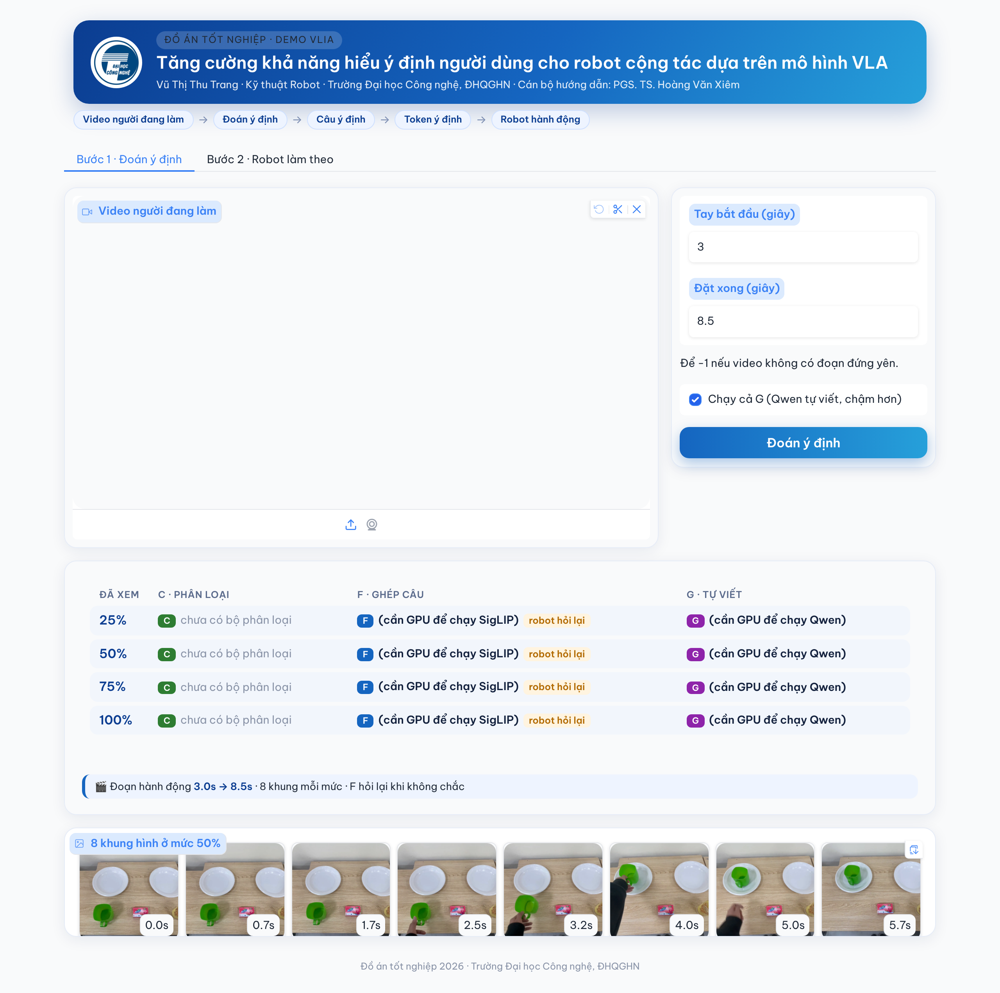

# VLIA: robot đoán ý định người dùng từ video và hành động không cần câu lệnh

Mã nguồn đồ án tốt nghiệp **"Tăng cường khả năng hiểu ý định người dùng cho robot cộng tác dựa trên mô hình VLA"**.

Sinh viên: Vũ Thị Thu Trang (22027515), ngành Kỹ thuật Robot, Trường Đại học Công nghệ, ĐHQGHN.
Cán bộ hướng dẫn: PGS. TS. Hoàng Văn Xiêm.

*English summary at the end of this file.*

## Ý tưởng

Mô hình VLA (thị giác, ngôn ngữ, hành động) chỉ biết mục tiêu qua câu lệnh. Trên LIBERO-10, SmolVLA có câu lệnh đúng hoàn thành 55/300 lượt, bỏ câu lệnh thì 0/300. VLIA cho robot tự đoán ý định từ phần đầu video người đang làm, rồi đưa ý định đó vào SmolVLA dưới dạng **một token ý định** thay cho câu lệnh.

```
video người (p% đầu) -> mô-đun ý định (C / F / G) -> câu ý định -> SigLIP văn bản
    -> Intention Adapter (1 lớp tuyến tính) -> 1 token -> SmolVLA (câu lệnh để trống) -> hành động
```

Ba mô-đun ý định:

| Mô-đun | Cách làm | Cần video có nhãn | Cần danh sách ý định |
|---|---|---|---|
| C | SigLIP + bộ phân loại có giám sát | Có | Có |
| F | So ảnh với từng câu ứng viên bằng SigLIP; độ chênh nhỏ thì robot hỏi lại | Không | Có |
| G | Qwen2.5-VL-3B tự viết câu "I want ..." | Không | Không |

## Kết quả chính

Mọi kết quả phía robot là trong **mô phỏng LIBERO-10**, với chính sách mới huấn luyện **25.000 bước**, một hạt giống. Số trong ngoặc vuông là khoảng tin cậy 95%.

**1. Token ý định thay được câu lệnh** (300 lượt mỗi dòng, `results/stage11_libero_goal/`)

| Điều kiện | Thành công |
|---|---|
| SmolVLA, câu lệnh đúng (mức trần) | 55/300 (18,3%) |
| SmolVLA, không câu lệnh | 0/300 |
| VLIA, không câu lệnh, token câu gốc | 52/300 (17,3%) |
| VLIA, token câu diễn đạt lại | 52/300 |
| VLIA, token câu nói bằng mục đích | 44/300 |
| VLIA, token của nhiệm vụ khác | 3/300 (1,0%) |

**2. Đoán ý định sớm bằng phân loại có giám sát (C)**, kiểm tra chéo 5 phần trên 379 video LIBERO-10 (`results/stage15_supervised_early/`)

| Phần video đã xem | Khung đầu | 25% | 50% | 75% | 100% |
|---|---|---|---|---|---|
| Độ chính xác | 88,7% | 99,7% | 100% | 100% | 100% |

Lưu ý: chỉ khung đầu đã đúng 88,7%, vì mỗi nhiệm vụ LIBERO-10 có cách bày bàn riêng. Con số này chưa chứng minh mô hình đọc được hành động (xem mục 5).

**3. Tự viết ý định (G), không cho danh sách** (`results/stage14_generate_early/`, `results/stage14b_*`)

- Qwen2.5-VL-3B: câu tự viết khớp đúng nhiệm vụ 29,4% ở 25% video, 36,5% ở 50%, 41,8% ở 100% (đoán mò 10%).
- Sửa câu nhắc (G2): 30,8% ở 25% video, không hơn rõ. Cho thêm tên đồ vật (O1): 44,8%, nhưng ảnh xám chỉ có tên đồ vật cũng đã 50,2%, nên cái giúp là tên đồ vật chứ không phải video.
- Mô hình viết câu tự huấn luyện (W): 83,9% trên LIBERO-10 nhưng thua cách "trả câu của video huấn luyện gần nhất" (99,7%) và 0% với nhiệm vụ chưa thấy.
- Chấm tay câu tự viết: LIBERO 60 câu (đúng 2, đúng một phần 29, sai 29); EgoIntent 50 câu (10 / 20 / 20).

**4. Vòng kín: video -> ý định -> robot** (299 lượt, xem 25% đầu video, câu lệnh luôn để trống; `results/stage12_end_to_end/`, `results/stage15_supervised_early/`)

| Token ý định đến từ | Ý định đúng | Robot thành công |
|---|---|---|
| Nhãn thật (mức trần) | 100% | 52/299 |
| C: phân loại có giám sát | 99,7% | 52/299 |
| F: ghép câu, có hỏi lại ở 17% lượt kém chắc nhất (mô phỏng) | | 50/299 |
| F: ghép câu | 69,9% | 35/299 |
| G: tự viết | 29,4% | 6/299 |
| Token sai | 0% | 3/299 |

Ý định càng đúng, robot càng gần mức trần. Trần thấp (khoảng 17%) là giới hạn của chính sách nền, vì câu lệnh đúng cũng chỉ đạt 18,3%.

**5. Video người thật: mô hình nhìn hành động hay nhìn bàn?** 90 video tự quay (3 người, 5 bàn, nhiều nhiệm vụ dùng chung một bàn), tiêu chí đặt trước. Trong cùng bàn, bỏ ra một người (81 video, 4 bàn):

| Đầu vào | Độ chính xác |
|---|---|
| Đoán mò | 44,4% |
| Chỉ cảnh | 42,0% [31,8; 52,8] |
| Chỉ chuyển động, nửa đầu thao tác | 67,9% |
| Đầy đủ, nửa đầu thao tác | 74,1% [63,6; 82,4] |

Chỉ nhìn bàn thì không nhận ra nhiệm vụ, có chuyển động thì nhận ra. Nhưng đây là **nhận ra nhiệm vụ ngay sau khi tay chạm đồ vật** (ổn định từ khoảng 0,5 đến 1,25 giây sau lần chạm đầu), **không phải đoán trước**: trước lần chạm, mọi cách đều ở mức đoán mò. Hỏi lại theo độ chắc chưa tốt hơn hỏi ngẫu nhiên. Video người thật và mã của thí nghiệm này không có trong repo (video có hình người quay; mã nằm trên máy phòng thí nghiệm).

Quy tắc đạt/không đạt đặt trước và bảng chi tiết của mỗi thí nghiệm nằm trong `results/` (tệp `prereg_*.md`, `summary.md`, `DEVIATIONS.md`).

## Cấu trúc thư mục

```
policies/     Intention Adapter và SmolVLA có token ý định
vlia_data/    bộ dữ liệu LIBERO-10 kèm vector ý định để huấn luyện
scripts/      huấn luyện, chạy robot, ba mô-đun ý định (xem scripts/README.md)
app/          app demo Gradio: video -> ý định -> robot
results/      kết quả và quy tắc đặt trước (chỉ tệp nhỏ: csv, md, json, png)
docs/         ảnh giao diện app
```

| Phần | Tệp |
|---|---|
| Token ý định (đóng góp chính) | `policies/intention/adapter.py`, `policies/smolvla/modeling_smolvla.py` |
| Huấn luyện VLIA (câu lệnh để trống) | `scripts/train_intention_only_LIBERO7D.py` |
| Huấn luyện SmolVLA gốc để so sánh | `scripts/train_matched_oracle_LIBERO7D_FIXED.py` |
| Chạy robot trên LIBERO-10 (mọi điều kiện) | `scripts/libero_goal_ablation.py` |
| Mô-đun C (phân loại sớm) | `scripts/run_stage15_supervised.py` |
| Mô-đun F (ghép câu) + vòng kín | `scripts/run_stage12_e2e.py` |
| Mô-đun G (tự viết) | `scripts/run_stage14_generate.py` |
| App | `app/vlia_app.py`, `app/run_rollout.sh`, `app/make_token.py` |

## Cài đặt

Cần máy **Linux có GPU NVIDIA** (đồ án chạy trên Ubuntu). Mã chỉ được thử trên Linux.

Hai môi trường Python, giống lúc làm thí nghiệm:

1. **Môi trường LeRobot** (huấn luyện, chạy robot trong LIBERO): cài [LeRobot](https://github.com/huggingface/lerobot) kèm LIBERO theo hướng dẫn của LeRobot.
2. **Môi trường phân tích** (mô-đun ý định, app): `pip install -r requirements.txt`.

```bash
export VLIA_DATA_ROOT=/duong/dan/o_du_lieu   # nơi để dữ liệu, mô hình, kết quả trung gian
export HF_HOME=$VLIA_DATA_ROOT/hf_cache
```

Mô hình nền tải từ Hugging Face: `lerobot/smolvla_base`, `google/siglip-so400m-patch14-384`, `Qwen/Qwen2.5-VL-3B-Instruct`. Dữ liệu: `lerobot/libero` (LIBERO-10).

## Chạy app demo



- **Bước 1 · Đoán ý định**: tải lên video người đang làm; app cho câu ý định của C, F, G khi xem 25, 50, 75, 100% đoạn hành động. F báo "robot hỏi lại" khi không chắc.
- **Bước 2 · Robot làm theo**: chọn câu ý định và cảnh LIBERO-10; robot chạy một lượt **không có câu lệnh**, chỉ nhận token ý định; app hiện video robot.

```bash
# 1) một lần: huấn luyện bộ phân loại C cho app (cần đặc trưng từ "run_stage15_supervised.py extract")
python scripts/train_app_classifier.py            # tạo app/classifier_svm_lin.npz

# 2) chạy app
export PY=$(which python)                          # môi trường phân tích
export VPY=$HOME/lerobot/.venv/bin/python          # môi trường LeRobot có LIBERO
export LEROBOT_DIR=$HOME/lerobot
python app/vlia_app.py --vlia-checkpoint /duong/dan/checkpoint/pretrained_model
# thêm --share để có link công khai, --port để đổi cổng
```

Mở `http://localhost:7860`. Nếu video có đoạn đứng yên ở đầu, nhập giây tay bắt đầu chạm đồ vật và giây đặt xong đồ vật cuối. Thiếu bộ phân loại thì cột C hiện "chưa có bộ phân loại"; thiếu GPU thì F, G không chạy.

## Chạy lại thí nghiệm

```bash
# kiểm thử nhanh, không cần GPU hay dữ liệu
cd scripts && python test_stage12.py && cd ..

# huấn luyện VLIA (môi trường LeRobot)
python scripts/train_intention_only_LIBERO7D.py --condition intention_only \
  --output-root $VLIA_DATA_ROOT/vlia_outputs/train --steps 100000 --batch-size 32 --save-freq 2500 --seed 0

# robot: token đúng và token sai, 30 lượt mỗi nhiệm vụ
python scripts/libero_goal_ablation.py --out OUT --conditions I-only,I-wrong --episodes-per-task 30 \
  --policy.path=CHECKPOINT --env.type=libero --env.task=libero_10 --eval.n_episodes=1 --eval.batch_size=1 \
  --rename_map '{"observation.images.image":"observation.images.camera1","observation.images.image2":"observation.images.camera2"}'

# mô-đun C: trích đặc trưng, kiểm tra chéo, phân tích
python scripts/run_stage15_supervised.py extract && python scripts/run_stage15_supervised.py cv && python scripts/run_stage15_supervised.py analyze

# mô-đun G: sinh câu, lập token, phân tích
python scripts/run_stage14_generate.py gen-libero && python scripts/run_stage14_generate.py plan && python scripts/run_stage14_generate.py analyze
```

Mỗi script có `--help`. Lượt thứ `e` của nhiệm vụ `t` luôn dùng vị trí ban đầu `e` và hạt giống `1000 + e`, nên mọi điều kiện được so trên cùng các lượt.

## Giới hạn

- Robot chỉ thử trong mô phỏng LIBERO-10 (10 nhiệm vụ đóng), chưa có robot thật.
- Chính sách mới huấn luyện 25.000 bước, một hạt giống; bản 100.000 bước đang huấn luyện.
- Trên LIBERO-10 cảnh làm lộ nhiệm vụ; trên video người thật mới nhận ra nhiệm vụ sau khi tay chạm, chưa đoán trước được.
- Hỏi lại là mô phỏng: câu trả lời của người được thay bằng nhãn đúng.

## Mô hình đã huấn luyện

Checkpoint không nằm trong repo vì dung lượng lớn. Link tải: (sẽ điền sau).

## English summary

VLIA lets a VLA policy (SmolVLA) act **without a language instruction**: an intention predicted from the first part of a human video is encoded by SigLIP and mapped by a single linear *Intention Adapter* to one extra prefix token. All robot results are in LIBERO-10 simulation with a 25k-step policy and one seed.

- Intention token replaces the instruction: 0/300 with an empty instruction → **52/300** with the intention token (instruction ceiling 55/300); paraphrase 52/300; wrong-task token 3/300.
- Supervised early intention (C): 99.7% after 25% of the video (5-fold CV, 379 videos), but the first frame alone already gives 88.7% because each LIBERO-10 task has its own scene layout.
- Open-ended generation (G, Qwen2.5-VL-3B, no label list): 29.4% at 25% of the video; prompt and self-trained writer variants did not close the gap.
- Closed loop (299 episodes, 25% of the video): C 52/299, F 35/299 (50/299 with simulated ask-back on 17% of episodes), G 6/299, wrong token 3/299.
- Own human videos (90 clips, 3 people, 5 tables, pre-registered): within a shared table, scene only 42.0% (chance 44.4%) vs scene + motion 74.1% at half of the manipulation. This is **task recognition shortly after the hand touches an object** (stable from ~0.5–1.25 s after first contact), **not anticipation before contact**. Calibrated ask-back did not beat random asking.

Main code: `policies/intention/adapter.py`, `policies/smolvla/modeling_smolvla.py`, `scripts/train_intention_only_LIBERO7D.py`, `scripts/libero_goal_ablation.py`, `scripts/run_stage15_supervised.py` (C), `scripts/run_stage12_e2e.py` (F), `scripts/run_stage14_generate.py` (G), demo `app/vlia_app.py`. Requires Linux + NVIDIA GPU.

## Giấy phép / License

MIT, xem `LICENSE`.
